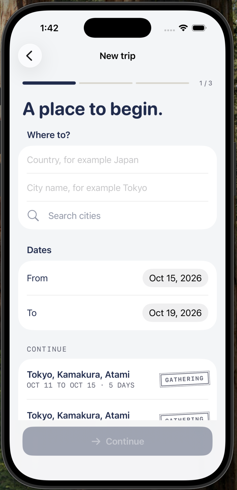
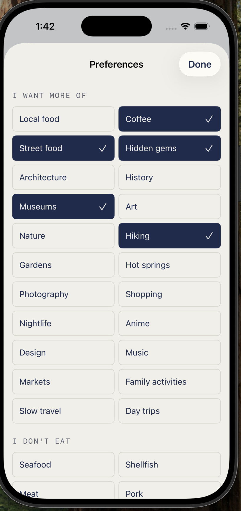
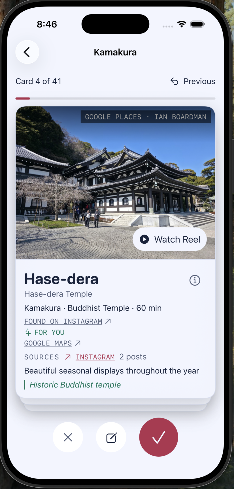
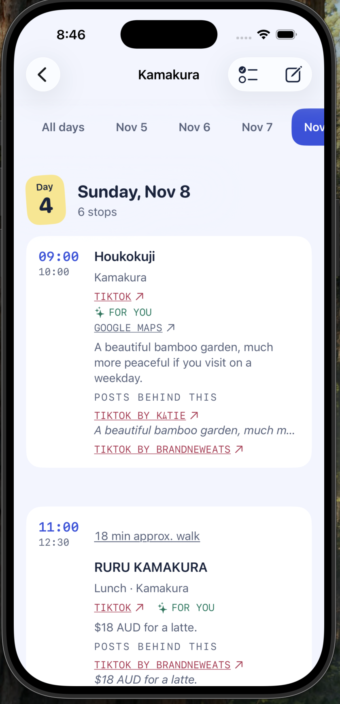
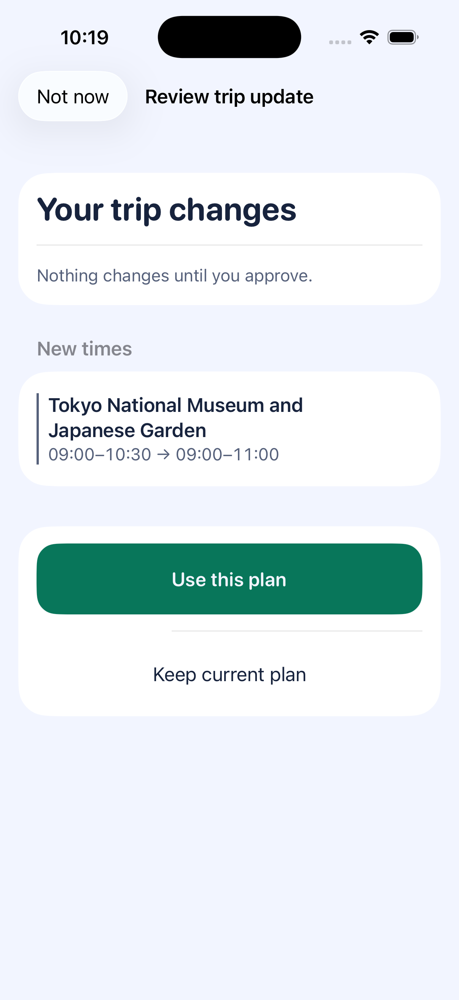
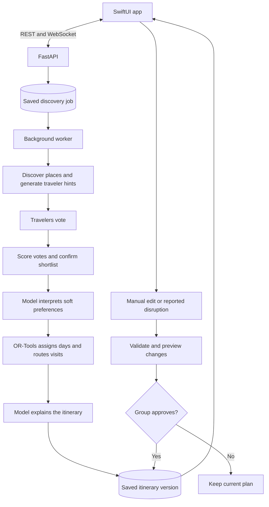

# Syncinerary

**An AI travel agent that helps a group turn saved places into a trip they can agree on.**

Planning a group trip usually starts with a chat full of links. One person saves
restaurants, another wants museums, and someone else just wants a relaxed day.
Turning those ideas into a schedule means finding common ground and working out
what actually fits.

Syncinerary brings that process into one iOS app. Friends share places, vote on
what they want to do, and review a plan built around their choices. Behind the
app, a stateful AI agent discovers places, interprets preferences, and explains
the itinerary. A constraint solver handles the timing and routes, while the
group stays involved at the points where a decision matters.

**Stack:** Python · LangGraph · Anthropic Claude · OR-Tools · FastAPI · PostgreSQL · Redis · SwiftUI

[The app](#the-app) · [The AI agent](#how-the-ai-agent-works) ·
[Architecture](#architecture) · [Testing](#testing-and-evaluation) · [Local setup](#run-locally)

## The app

Create a trip, choose the cities and dates, and invite friends into the group
chat. Everyone can add interests and dietary preferences. Instagram, TikTok,
and RedNote links shared in the conversation go into a shared collection for discovery.

When the group is ready, the agent gathers candidates and each traveler votes
through a swipe deck. People can add a note to a vote or flag a place they really
want to visit. The group then reviews the shortlist before the planner builds
the itinerary, including lodging, travel time, and meal breaks.

The plan remains editable. Add a stop, move a visit, or report a disruption, then
review the proposed changes before applying them. Shared checklists and saved
links stay with the trip so the group can keep preparing together.

<table>
  <tr>
    <th>Start a trip</th>
    <th>Choose your preferences</th>
    <th>Discover and vote</th>
  </tr>
  <tr>
    <td></td>
    <td></td>
    <td></td>
  </tr>
</table>

<details>
<summary>See the itinerary and change review</summary>

<table>
  <tr>
    <th>See the daily plan</th>
    <th>Review a change</th>
  </tr>
  <tr>
    <td></td>
    <td></td>
  </tr>
</table>

*The change review screenshot uses sample trip data.*

</details>

## How the AI agent works

The backend uses LangGraph to carry a trip through discovery, traveler feedback,
planning, and explanation. Its state includes the group's preferences, candidate
places, votes, constraints, and planning results. PostgreSQL checkpoints let the
workflow pause for people and resume with their decisions.

### 1. Find places worth considering

Discovery combines public social-post metadata, traveler-shared links, and
Google Places. Claude extracts named places and useful context from the available
text. Place lookups then check the location and details, and duplicate mentions
are combined into one candidate with its source links intact.

Search adapts to what has already been found. The search policy tracks which
queries add useful places and whether the trip still needs restaurants,
attractions, or less obvious local spots. It can try another query or platform
when a search produces little, within a fixed budget. Google Places fills gaps
when social sources do not provide enough candidates.

The group's language follows the trip through discovery and explanation.
For Chinese trips, automatic social posts need meaningful Chinese text in the
original public metadata. Translating an English card alone does not satisfy
that check.

### 2. Understand each traveler

A delegate step reads each traveler's profile and adds relevant hints to the
candidate cards. A restaurant might receive a dietary warning, while a place
that matches someone's interests can get a positive note.

Travelers can also vote with a comment, such as “I can get my own lunch here”
or “I'd go if we keep the visit short.” The model turns these comments into
structured information that later stages can use.

The group keeps the final say. Votes are scored by a reproducible function,
and the shortlist waits for confirmation. Shared interests guide discovery:
the five interests supported by the most members get priority, while individual
profiles and hard dietary constraints are retained.

### 3. Turn the choices into a schedule

Once the shortlist is confirmed, a model translates stated soft preferences
into bounded weights for the planner. OR-Tools then assigns places to days and
works out the order and times within each day. The scheduling constraints cover
opening hours, reservations, travel time, fatigue, and the available day window.

This division gives each part a clear job. The model interprets what the group
cares about; the solver checks what fits using the available place and travel
data. The explanation step describes the resulting plan and why some requested
places could not be included.

### 4. Help when the plan changes

A closed venue, a missed reservation, or a late start can affect the rest of a
day. The replan workflow identifies the affected stops, protects fixed bookings,
looks for suitable alternatives, and runs the scheduling logic again for that
day.

The result is a proposal with a record of the alternatives considered and a
diff showing what would change. The group can accept it or keep the current
plan. Manual edits use the same versioned approval flow, so reviewing a change
does not overwrite the active itinerary.

### 5. Keep the work recoverable and observable

Discovery runs in a separate worker so it can continue after the app closes.
Each job stores its input snapshot, progress, and heartbeat. Database locks
coordinate workers, and checkpoints allow interrupted work to resume.

Model and tool calls pass through a shared reliability harness. It validates
inputs, limits repair attempts, detects repeated work, and enforces step and
model-cost budgets. OpenTelemetry traces in Phoenix make it possible to follow
a run and investigate where it slowed down or failed.

The main entry points are the [agent graph](syncinerary/agents/graph.py),
[discovery workflow](syncinerary/agents/gather/social.py),
[reliability harness](syncinerary/harness/wrapper.py), and
[replan workflow](syncinerary/agents/rescue.py).

## Architecture



The SwiftUI app communicates with an async FastAPI backend. LangGraph manages
the planning workflow, PostgreSQL stores shared trip data and checkpoints, and
Redis supports caching, rate limits, and live updates. The API and discovery
worker run as separate processes.

Claude handles extraction, annotations, note interpretation, preference weights,
and explanations. Brave Search provides social discovery; Google Places and
Routes provide place and travel data; Open-Meteo supplies weather forecasts.
The two scheduling stages use OR-Tools CP-SAT.

## Testing and evaluation

The project has tests for the planning flow and the failures around it: duplicate
job starts, interrupted workers, stale itinerary edits, invalid tool arguments,
and access to another group's data.

The **October 2, 2026** verification run passed **914 backend tests**, **10 Swift
contract and view-model test programs**, and the iOS Simulator build. Database
migrations also passed an upgrade, downgrade, and upgrade cycle in a disposable
database.

Agent evaluation includes **10 itinerary scenarios** and **14 place-admission
cases**. The default evaluation runs without model calls so it can act as a
repeatable CI check. A deliberately disabled fatigue cap makes the evaluation
fail, confirming that the checks catch a broken planning constraint. An optional
DeepEval judge path is available for model-based evaluation.

```bash
# With PostgreSQL and Redis running:
.venv/bin/python -m pytest tests/ -q
.venv/bin/ruff check syncinerary tests
.venv/bin/python -m syncinerary.eval.runner --no-store
.venv/bin/python -m syncinerary.eval.discovery

# Expected to fail: proves the evaluation catches a broken fatigue constraint.
.venv/bin/python -m syncinerary.eval.runner --break fatigue-cap --no-store

# On macOS with Xcode:
bash scripts/test_ios.sh
```

## Run locally

You'll need `uv`, Docker Compose, and Xcode for the iOS app.

```bash
uv venv --python 3.12
uv pip install -e '.[dev]'
cp .env.example .env
docker compose up -d --wait
.venv/bin/alembic upgrade head
```

For live discovery, set `GOOGLE_MAPS_API_KEY` and `BRAVE_SEARCH_API_KEY` in
`.env`. Configure `SYNC_CREDENTIAL_ENCRYPTION_KEYS` with a versioned keyring of
base64url-encoded 32-byte AES keys and select its active version with
`SYNC_CREDENTIAL_ENCRYPTION_ACTIVE_VERSION`. The trip creator saves their
Anthropic key through **AI access** in the app, and members grant consent
before AI work starts.

Start the API and worker in separate terminals:

```bash
.venv/bin/python -m syncinerary.api.server
```

```bash
.venv/bin/python -m syncinerary.workers.gather
```

Open `ios/Syncinerary.xcodeproj`, select the `Syncinerary` scheme, and run an
iPhone Simulator. The app connects to `http://localhost:8000` by default.
Phoenix traces are available at `http://localhost:6006`.

## Finding your way around

```text
syncinerary/
  agents/       Planning graph, discovery, delegates, solver, and replans
  harness/      Tool validation, retries, loop detection, and budgets
  workers/      Background discovery and recovery
  api/          Accounts, trip endpoints, and WebSocket handling
  domain/       Typed trip state and validation
  store/        Repositories, migrations, and database connections
  tools/        Places, social metadata, weather, and transit integrations
  obs/          Tracing and Phoenix configuration
  eval/         Scenarios, scorers, and regression checks
ios/            SwiftUI app and client tests
tests/          Backend tests
evidence/       Screenshots and dated discovery experiments
```
