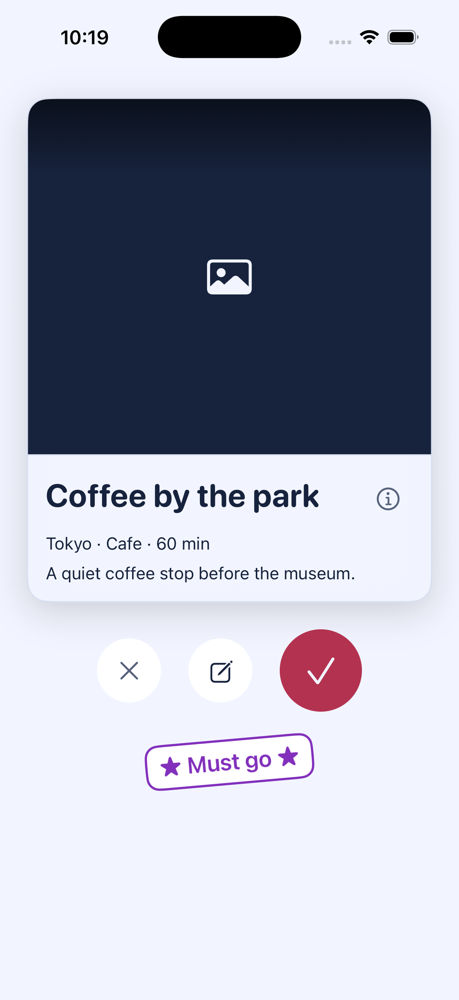
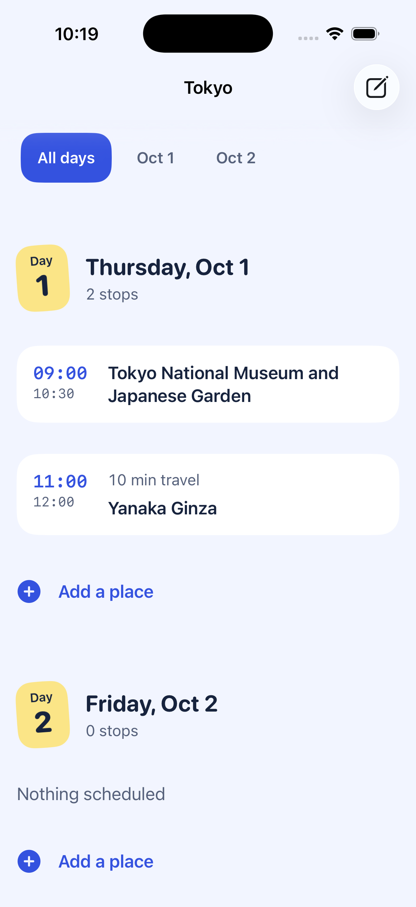
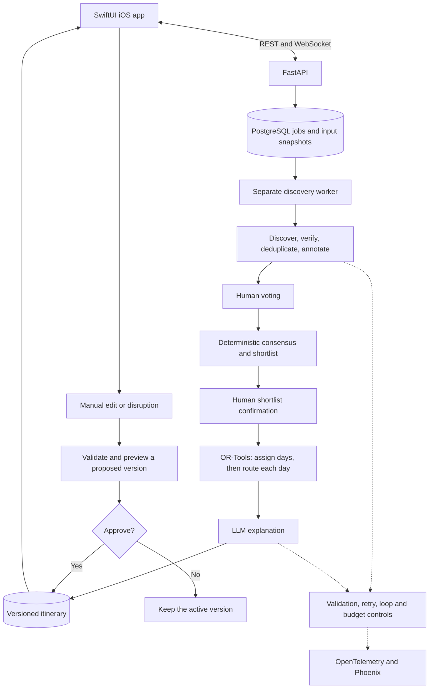

# Syncinerary

**From saved places and group preferences to a shared, editable travel plan.**

Syncinerary is a native iOS group travel planner with a Python agent backend.
Friends share social posts, vote on places, and confirm a shortlist. A two-stage
constraint solver turns those choices into daily schedules with opening hours,
travel times, meals, and reservations. When plans change, the app previews the
changes and asks for approval before replacing the active itinerary.

The central engineering decision: **language models interpret and explain;
deterministic code scores preferences, validates constraints, and schedules visits.**

Python 3.12 · FastAPI · LangGraph · OR-Tools CP-SAT · PostgreSQL · Redis · SwiftUI

[Product walkthrough](#product-walkthrough) · [Architecture](#architecture) ·
[Engineering decisions](#engineering-decisions) · [Verification](#verification) ·
[Run locally](#run-locally) · [Current status](#current-status)

## At a glance

| Area | What this repository demonstrates |
|---|---|
| Applied AI | Tool-based place discovery, structured extraction, traveler-specific annotations, and grounded explanations |
| Backend systems | Durable background work, checkpoint recovery, concurrent request protection, authenticated APIs, and versioned data |
| Optimization | Separate day assignment and within-day routing, with hard constraints and explicit reasons for unplaced stops |
| Product engineering | Native iOS accounts, group chat, shared links, voting, lodging selection, checklists, and itinerary editing |
| Evaluation | Automated regressions, deterministic scenario evaluation, failure injection, and traceable discovery experiments |

**Status:** a working local prototype with automated backend checks and an iOS
Simulator build. OAuth provider activation, physical-device verification, and
public deployment remain separate release work. See [current status](#current-status).

## Product walkthrough

1. **Create a group.** Choose up to four cities in one country, dates, days per
   city, interests, and dietary exclusions. Invite friends to the group chat.
2. **Collect ideas.** Supported Instagram, TikTok, and RedNote links sent in
   chat become shared saved links. Members can update their own preferences.
3. **Discover places.** The leader starts a background job. Public social
   metadata introduces candidates; Google Places verifies them and fills gaps.
   The app shows progress and can reconnect after being closed.
4. **Decide together.** Travelers swipe, add notes, and mark favorites.
   Deterministic scoring builds a shortlist that the group reviews and confirms.
5. **Build the itinerary.** Select lodging or record an already-booked hotel.
   The planner assigns places to days, orders visits, and accounts for travel
   and meal times. Unplaced choices keep an explanation.
6. **Adapt the plan.** Add, remove, reorder, or retime stops. Manual edits and
   disruption-driven replans create proposals with a diff. Approval activates
   a new version; rejection keeps the existing one.

<table>
  <tr>
    <th>Vote on places</th>
    <th>Read the daily plan</th>
    <th>Approve changes</th>
  </tr>
  <tr>
    <td></td>
    <td></td>
    <td></td>
  </tr>
</table>

These Simulator captures use fixture data to demonstrate real UI components,
including placeholder imagery. They are interface examples, not a live trip
benchmark. [Visual verification notes](evidence/ui-refresh/verification.md)
include light, dark, larger-text, and motion checks.

## Architecture



[LangGraph](syncinerary/agents/graph.py) persists execution checkpoints and
pauses at human decision boundaries. PostgreSQL owns trips, votes, jobs, and
itinerary history. Redis supplies caches, rate limits, and messaging
infrastructure. External integrations sit behind typed tool contracts; the
[harness](syncinerary/harness/wrapper.py) accounts for model and tool activity.

| Layer | Implementation |
|---|---|
| Client | SwiftUI, Observation, async networking, Keychain sessions; iOS 17+ |
| API | Async FastAPI, Pydantic request/response models, REST and WebSocket endpoints |
| Orchestration | LangGraph with PostgreSQL checkpoints and a separate worker process |
| Planning | OR-Tools CP-SAT for day assignment and within-day scheduling |
| Persistence | PostgreSQL 16, SQLAlchemy, Alembic; pgvector extension in the schema |
| AI and providers | Anthropic, Brave Search, Google Places/Routes, Open-Meteo; optional HERE transit fallback |
| Observability and evaluation | OpenTelemetry, OpenInference, Phoenix, pytest; optional DeepEval judge path |

## Engineering decisions

### Keep model judgment separate from feasibility

Models extract place names, interpret traveler notes, annotate candidate cards,
suggest soft-preference weights, and explain results. Vote aggregation,
shortlist selection, and scheduling use deterministic code. The solver checks
the supplied opening hours, reservations, travel times, and daily constraints;
the narrative cannot silently change its answer.

The two-stage design separates **which day** a place belongs on from **when and
in what order** it can be visited. It also lets a replan target affected days.
Feasibility depends on the supplied data: unknown hours, estimated travel, and
missing dietary details remain limitations rather than real-world guarantees.

Read: [consensus](syncinerary/agents/aggregate.py),
[day assignment](syncinerary/agents/solver/stage1_days.py),
[routing](syncinerary/agents/solver/stage2_route.py),
[SDK boundary tests](tests/test_m2_sdk_boundary.py).

### Make long-running discovery recoverable

Starting discovery stores an immutable snapshot of the trip, travelers,
constraints, and attachments. A separate worker claims the job with a
PostgreSQL advisory lock and maintains a heartbeat. Checkpoints allow interrupted
work to resume without treating a closed app or dropped HTTP request as a lost
trip. Duplicate start requests coalesce, and retries are bounded.

PostgreSQL owns both the job and its inputs, avoiding a database/broker dual
write at job creation. This supports recovery; it is not a claim of exactly-once
execution for external provider calls.

Read: [job repository](syncinerary/store/repositories/gather.py),
[worker](syncinerary/workers/gather.py),
[recovery tests](tests/test_gather_recovery.py).

### Preserve evidence and report discovery shortfalls

Candidates retain source URLs, public-text evidence, and contributor attribution
after deduplication. Group interests are ranked by shared support and capped at
five discovery interests; full individual profiles and hard dietary constraints
remain available. Chinese trips require meaningful Chinese text in the original
automatic social source, rather than treating translated card copy as evidence.

Discovery targets 60% Reel-backed cards across the trip, while respecting city,
food, and hidden-gem coverage. Search and verification are bounded at eight
searches per city and 40 social place verifications per trip. A sparse destination
can miss the target; the deck is not shrunk to manufacture a better percentage.

Historical [discovery experiments](evidence/reels/README.md) retain misses as
well as successes. Those samples predate the latest Chinese-source filter and
are not a current coverage guarantee or a controlled A/B benchmark.

Read: [admission checks](syncinerary/agents/gather/admission.py),
[source metrics](syncinerary/agents/gather/source_mix.py),
[Chinese-source regressions](tests/test_chinese_social_content.py).

### Make consequential edits reviewable

Manual edits and replans create append-only itinerary versions. Validation
protects fixed reservations, rejects stale base versions, and checks changed
days before presenting a proposal. The active itinerary stays unchanged until
approval. A rejection preserves the current plan and records the decision.

Read: [manual edit validation](syncinerary/agents/manual_itinerary.py),
[replan API](syncinerary/api/routers/replans.py),
[manual-edit regressions](tests/test_manual_itinerary.py).

### Put credentials and failure controls at explicit boundaries

Email accounts use Argon2id password hashes and opaque, revocable sessions.
The app stores its session in Keychain. Google and Apple identities are verified
by provider subject, with signature, audience, issuer, expiry, and single-use
nonce checks; matching email addresses do not automatically link accounts.

Account-owned trips use the creator's Anthropic key. It is encrypted using
AES-256-GCM with account-bound authenticated data and a versioned keyring.
Every member must grant AI data-sharing consent. The shared harness validates
tool inputs, bounds repairs, detects repeated work, and enforces step and
model-cost limits. Sensitive trace content is disabled by default.

Read: [credential encryption](syncinerary/security/credentials.py),
[provider identity verification](syncinerary/api/social_auth.py),
[privacy and access tests](tests/test_app_store_readiness.py),
[BYOK operations](docs/ANTHROPIC_BYOK.md).

## Verification

Local verification on **October 2, 2026**:

| Check | Result |
|---|---|
| Python unit and integration suite | 914 passed, with PostgreSQL and Redis available |
| Database migrations | Full upgrade, downgrade to base, then upgrade passed in a disposable database |
| Python static checks | Ruff passed |
| iOS | Debug Simulator build passed; all 10 Swift contract/view-model test executables passed |
| Deterministic evaluations | 10/10 itinerary scenarios and 14/14 discovery admission cases passed |
| Failure injection | Deliberately disabling the fatigue cap produced the expected failing evaluation |

See the [verification record](docs/VERIFICATION.md) for commands, scope, and limits.

The [CI workflow](.github/workflows/ci.yml) runs backend tests, lint, SDK-boundary
checks, and deterministic itinerary evaluations. The evaluation suite includes
10 itinerary scenarios, a deliberate fatigue-cap failure mode, and a separate
14-case discovery admission gate. Default evaluation makes no model calls;
the optional LLM judge is kept out of the normal CI path. Swift checks currently
run locally on macOS.

```bash
# Start the real local services before testing; DB tests otherwise skip.
docker compose up -d --wait
.venv/bin/alembic upgrade head
.venv/bin/python -m pytest tests/ -q
.venv/bin/ruff check syncinerary tests

# Deterministic scenario and discovery checks.
.venv/bin/python -m syncinerary.eval.runner --no-store
.venv/bin/python -m syncinerary.eval.discovery

# This deliberately broken run should exit nonzero.
.venv/bin/python -m syncinerary.eval.runner --break fatigue-cap --no-store

# macOS with Xcode: API contracts and view-model regressions.
bash scripts/test_ios.sh
```

Automated provider tests use controlled responses. A passing suite does not
establish OAuth provisioning, live social coverage, or physical-device behavior.

## Run locally

### 1. Install and start infrastructure

Prerequisites: Python 3.12 through `uv`, Docker Compose, and Xcode for the iOS app.

```bash
uv venv --python 3.12
uv pip install -e '.[dev]'
cp .env.example .env
docker compose up -d --wait
.venv/bin/alembic upgrade head
```

For tests and deterministic evaluations, the development database and Redis
defaults are sufficient. For live discovery, configure the following in the
gitignored `.env`:

| Setting | Purpose |
|---|---|
| `GOOGLE_MAPS_API_KEY` | Place lookup/verification and the configured Google routing integration |
| `BRAVE_SEARCH_API_KEY` | Public social-post discovery |
| `SYNC_CREDENTIAL_ENCRYPTION_KEYS` | A real AES-256 keyring for encrypted creator credentials; replace the template value using the [BYOK guide](docs/ANTHROPIC_BYOK.md) |
| `SYNC_CREDENTIAL_ENCRYPTION_ACTIVE_VERSION` | Selects the active encryption-key version |

The trip creator saves their Anthropic key in the app's **AI access** settings.
Each member grants consent before AI work starts. A server `ANTHROPIC_API_KEY`
is only a local/legacy fallback and does not replace creator credentials for
account-owned trips. Live discovery calls external services and may incur fees.

Email signup does **not** require SMTP or a verification email. SMTP is needed
for password recovery. Google and Apple registration require their own provider
configuration. Details: [email access](docs/EMAIL_SIGN_IN.md),
[social sign-in](docs/SOCIAL_SIGN_IN.md).

### 2. Run both backend processes

```bash
# Terminal 1: API, available to the Simulator and local network.
.venv/bin/python -m syncinerary.api.server
```

```bash
# Terminal 2: durable discovery worker, using the same environment/database.
.venv/bin/python -m syncinerary.workers.gather
```

Open [API documentation](http://localhost:8000/docs),
[health](http://localhost:8000/health), and [Phoenix](http://localhost:6006).
The worker is a separate process; starting the API alone does not process
discovery jobs.

### 3. Run the iOS app

Open `ios/Syncinerary.xcodeproj`, select the shared `Syncinerary` scheme, and
run an iPhone Simulator. The default API origin is `http://localhost:8000`.
Create an account, start a group, configure AI access, and invite another member
to exercise the full planning flow.

See the [iOS guide](ios/README.md) for configuration and tests, and the
[iPhone testing guide](docs/IPHONE_TESTING.md) for device networking and signing.
A [Dockerfile](Dockerfile) is provided for the API and worker;
[deployment notes](docs/PRODUCTION_DEPLOYMENT.md) describe their separate lifecycles.

## Repository map

```text
syncinerary/
  agents/       Graph, discovery, delegates, consensus, solver, explanation, replans
  api/          Authentication, trip APIs, wire contracts, WebSocket handling
  workers/      Durable discovery worker
  harness/      Typed calls, repair limits, loop detection, budget accounting
  domain/       Domain models and validation
  store/        Repositories, SQLAlchemy tables, migrations, database connections
  tools/        Places, social metadata, weather, and transit integrations
  obs/          OpenTelemetry and Phoenix configuration
  eval/         Deterministic fixtures, scorers, discovery regressions, runner
ios/            SwiftUI app and Swift regression checks
tests/          Backend acceptance and regression tests
docs/           Account, deployment, privacy, and device-testing guides
evidence/       Dated screenshots, validation notes, and discovery experiments
scripts/        Local verification and explicitly invoked live diagnostics
```

## Current status

| Area | Status and practical limit |
|---|---|
| Planning workflow | Implemented from group setup through voting, scheduling, and approved revisions; verified locally |
| Discovery | Live integrations and bounded recovery exist; source availability and language evidence vary by destination |
| Email accounts | Immediate signup and sign-in implemented; addresses are unverified at signup; recovery needs SMTP |
| Google / Apple | Client flows and server verification implemented and tested with synthetic signed identities; real provider setup and device checks remain |
| iPhone password saving | AutoFill field types are prepared; associated-domain configuration and device validation remain |
| iOS accessibility | Larger-text and dark-mode screenshots, contrast checks, and Reduce Motion handling; physical VoiceOver and haptic review remain |
| Deployment | Container and release guidance exist; this README does not claim a hosted service, App Store release, or production usage |
| Data limitations | Dietary unknowns need confirmation; lodging records do not verify availability or make bookings; travel estimates are labeled |

The [build brief](CLAUDE.md) records design decisions and scope. Dated files
under `evidence/` preserve what was measured at that time, including earlier
interfaces and behavior that later changed.
